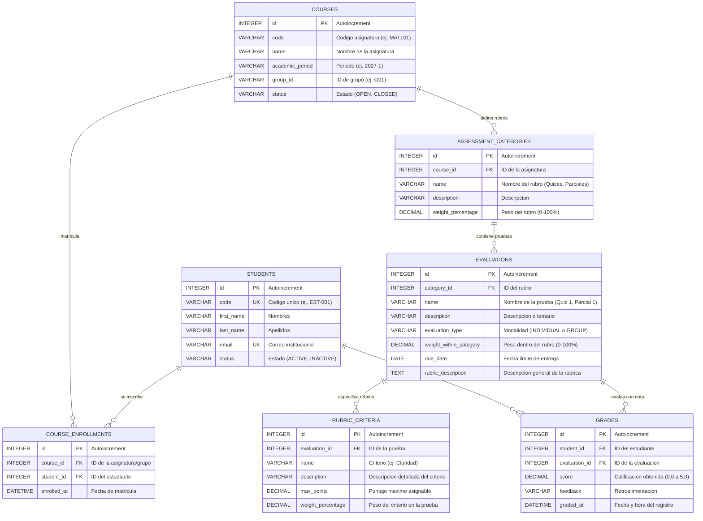

# Notas MCP Server 🎓

> **Servidor MCP (Model Context Protocol)** desarrollado en **Java 25** con **Spring Boot 4.x** y **Spring AI 2.0.x**, con persistencia local en **SQLite**, diseñado para que asistentes y agentes de Inteligencia Artificial gestionen de forma autónoma y estructurada estudiantes, cursos, evaluaciones y calificaciones con cálculo automático de notas definitivas ponderadas.
>
> **Estado:** ✅ **Funcional end-to-end.** Modelo de dominio rico (rich domain model), 25 herramientas MCP operativas y cálculo de definitiva ponderado verificado por protocolo JSON-RPC real.

---

## 📋 1. Definición del Proyecto

El **Notas MCP Server** actúa como un puente estandarizado mediante el protocolo abierto **Model Context Protocol (MCP)**, permitiendo a Modelos de Lenguaje (LLMs) como Claude, Gemini, ChatGPT o agentes autónomos interactuar con un sistema de gestión académica local de alto rendimiento.

### Objetivos Clave:
* **Autonomía para Asistentes IA:** Exponer herramientas fuertemente tipadas (`@Tool`) que permiten registrar estudiantes, definir cursos y pruebas académicas con pesos porcentuales, asentar notas y calcular promedios ponderados.
* **Persistencia Ligera y Confiable:** Uso de una base de datos local **SQLite**, garantizando portabilidad absoluta y cero dependencias de red o servicios externos.
* **Vanguardia Tecnológica y Código Limpio:** Aprovechar las innovaciones de **Java 25** (Records inmutables como Value Objects, Pattern Matching) y la arquitectura modular de **Spring Boot 4 / Spring Framework 7**, siguiendo estrictamente principios **SOLID**, **Clean Code**, **Clean Architecture (Puertos y Adaptadores)** y **Domain-Driven Design (modelo de dominio rico)**.

---

## 🛠️ 2. Stack Tecnológico

| Componente | Tecnología | Versión | Justificación |
| :--- | :--- | :--- | :--- |
| **Lenguaje** | Java | 25 (LTS) | Records inmutables para Value Objects y DTOs, Pattern Matching y Virtual Threads. |
| **Framework Base** | Spring Boot | 4.0.x | Basado en Spring Framework 7 y Jakarta EE 11; arquitectura modular y soporte nativo Java 25. |
| **Integración IA/MCP** | Spring AI | 2.0.x | Soporte de MCP Server compatible con Spring Boot 4 (transporte STDIO local y SSE/HTTP). |
| **Base de Datos** | SQLite | 3.x | Motor SQL embebido local en archivo (`notas.db`), rápido, ligero y autónomo. |
| **Capa de Persistencia** | Spring Data JPA + Hibernate Community | 7.x | Abstracción ORM con dialecto comunitario oficial de SQLite compatible con Jakarta EE 11. |
| **Controlador JDBC** | `org.xerial:sqlite-jdbc` | 3.47.x | Driver JDBC nativo de alto rendimiento para SQLite. |
| **Gestor de Compilación**| Apache Maven + Maven Wrapper | 3.9.9 (`mvnw`) | Builds reproducibles y portables entre entornos y CI/CD. |
| **Pruebas Unitarias** | JUnit 5 + AssertJ | - | Verificación aislada de invariantes del dominio, servicios de aplicación y cálculo de notas. |

---

## 🏛️ 3. Arquitectura: Módulos Verticales + Modelo de Dominio Rico

El sistema implementa **Clean Architecture (Arquitectura Hexagonal / Puertos y Adaptadores)** organizada en **módulos verticales por dominio** (no por capas técnicas). El dominio académico sigue un **Modelo de Dominio Rico** (rich domain model): las entidades protegen sus propias invariantes, exponen comportamiento a través de métodos de fábrica y negocio, y usan Value Objects — implementados como **records de Java 25** — para garantizar un modelo siempre válido (*always-valid domain model*).

```
┌──────────────────────────────────────────────────────────────────────────┐
│                        MÓDULOS VERTICALES POR DOMINIO                    │
│                                                                          │
│   ┌──────────────┐  ┌──────────────┐  ┌───────────────┐  ┌────────────┐  │
│   │   student/   │  │   course/    │  │  evaluation/  │  │   grade/   │  │
│   ├──────────────┤  ├──────────────┤  ├───────────────┤  ├────────────┤  │
│   │ application/ │  │ application/ │  │ application/  │  │ domain/    │  │
│   │ domain/      │  │ domain/      │  │ domain/       │  │ application│  │
│   │ infra/mcp/   │  │ infra/mcp/   │  │ infra/mcp/    │  │ infra/mcp/ │  │
│   │ infra/pers/  │  │ infra/pers/  │  │ infra/pers/   │  │            │  │
│   └──────┬───────┘  └──────┬───────┘  └──────┬────────┘  └─────┬──────┘  │
│          │                 │                 │                 │         │
│          ▼                 ▼                 ▼                 ▼         │
│   ┌──────────────────────────────────────────────────────────────────┐   │
│   │                      shared/ (kernel compartido)                 │   │
│   │   domain/ (VOs reutilizables)  exception/  config/               │   │
│   └──────────────────────────────────────────────────────────────────┘   │
│                                                                          │
│   Cada módulo:                                                          │
│   • domain/         → agregados ricos + puertos (interfaces)             │
│   • application/    → servicios de uso que SOLO orquestan               │
│   • infrastructure/ → adaptadores de entrada (MCP @Tool) y de salida    │
│                       (SQLite + Spring Data JPA)                         │
└──────────────────────────────────────────────────────────────────────────┘
```

### Rol de cada capa:
1. **`infrastructure/mcp` (adaptadores de entrada):** Clases `@Component` con métodos `@Tool` que delegan exclusivamente en los servicios de aplicación. Registradas vía `MethodToolCallbackProvider` en `shared/config/McpServerConfig`.
2. **`application` (casos de uso):** Servicios delgados que **orquestan**: cargan agregados por sus puertos, invocan comportamiento de dominio, coordinan referencias cruzadas entre agregados y persisten. No implementan reglas de negocio.
3. **`domain` (núcleo):** Agregados raíz, entidades internas, Value Objects (records), enums y puertos de salida. Toda regla de negocio vive aquí.
4. **`infrastructure/persistence` (adaptadores de salida):** Entidades JPA, repositorios Spring Data y adaptadores que mapean dominio ↔ persistencia y sincronizan las entidades internas del agregado (agregadas y removidas).

---

## 🧬 4. Modelo de Dominio Rico

### 4.1 Agregados

```
   AGREGADO Student                 AGREGADO Course (Asignatura)
   ┌───────────────────┐            ┌────────────────────────────────┐
   │ Student  ← raíz   │            │ Course  ← raíz                 │
   │   (code único)    │            │  └─ AssessmentCategory (rubro) │
   └─────────┬─────────┘            └───────────┬────────────────────┘
             │ studentId (ref por ID)           │ categoryId (ref por ID)
             └────────────► AGREGADO Evaluation (Prueba/Notas)
                            ┌────────────────────────────────┐
                            │ Evaluation  ← raíz             │
                            │  ├─ RubricCriterion (rúbrica)  │
                            │  └─ Grade (nota)               │
                            └────────────────────────────────┘
```

Las referencias entre agregados son siempre **por identidad** (IDs), nunca por objeto.

### 4.2 Value Objects (records de Java 25)

| Value Object | Módulo | Invariante protegido |
| :--- | :--- | :--- |
| `WeightPercentage` | `shared/domain` | Peso porcentual en (0.0, 100.0], escala 2; `addedWouldExceedMax()` para las sumatorias de los agregados. |
| `Name` | `shared/domain` | Nombre obligatorio, ≤ 150 caracteres, normalizado (trimmed). |
| `Description` | `shared/domain` | Descripción opcional, ≤ 500 caracteres, normalizada. |
| `CourseCode` | `course/domain` | Código no vacío, ≤ 50 caracteres, formato `MAT101`, normalizado a mayúsculas. |
| `AcademicPeriod` | `course/domain` | **Enum** con catálogo finito de periodos válidos (ej. `2027-1`, `2027-3`); `from(String)` valida y centraliza el mensaje con los valores permitidos. |
| `GroupId` | `course/domain` | ID de grupo no vacío, ≤ 50 caracteres, normalizado a mayúsculas (ej. `G01`). |
| `GradeScore` | `evaluation/domain` | Calificación en la escala [0.0, 5.0], escala 2; `isPassing()` (≥ 3.0). |
| `MaxPoints` | `evaluation/domain` | Puntaje máximo de un criterio de rúbrica > 0. |
| `Feedback` | `evaluation/domain` | Retroalimentación opcional, ≤ 1000 caracteres. |

Cada VO valida y normaliza en su constructor compacto: **es imposible construir un estado inválido**.

### 4.3 Invariantes de los agregados

| Agregado | Invariantes |
| :--- | :--- |
| **Course** (raíz) | Sumatoria de pesos de rubros ≤ 100% (validada antes de mutar); nombres de rubros únicos; asignatura cerrada (`CLOSED`) no admite cambios de estructura; periodo académico del catálogo finito (enum). Identidad: (código, periodo, grupo). |
| **Evaluation** (raíz) | Peso dentro del rubro válido (VO); sumatoria de pesos de la rúbrica ≤ 100%; criterios con nombre único; **nota única por estudiante** (upsert en `recordGrade`); notas siempre en [0.0, 5.0] (VO). Identidad: (rubro, nombre). |
| **Student** (raíz) | Código único normalizado; correo con formato válido; estudiante inactivo no puede matricularse ni recibir notas (`validateCanBeEvaluated`). Identidad: código. |

### 4.4 Servicios de dominio

* **`FinalGradeCalculator`** (`grade/domain`): servicio **puro** (sin repositorios) que calcula la nota definitiva ponderada de un estudiante, atravesando los agregados Course y Evaluation:

```
definitiva = Σ (peso rubro / 100) × (peso evaluación dentro del rubro / 100) × nota
```
  Incluye el porcentaje acumulado (solo evaluaciones calificadas) y el estado: `APPROVED` (completa y ≥ 3.0), `REJECTED` (completa y < 3.0) o `IN_PROGRESS`.

### 4.5 Excepciones de dominio

* `DomainException` (base), `BusinessRuleException` (reglas/invariantes), `EntityNotFoundException` (entidad inexistente) — en `shared/exception`.

---

## 📁 5. Scaffolding del Proyecto

Estructura de directorios y paquetes:

```text
notas-mcp-server/
├── .mvn/wrapper/                               # Maven Wrapper (3.9.9)
├── src/
│   ├── main/
│   │   ├── java/com/aabg/notas/
│   │   │   ├── NotasMcpApplication.java        # Punto de entrada Spring Boot 4
│   │   │   ├── shared/                         # Kernel compartido
│   │   │   │   ├── config/                     # McpServerConfig, SqliteConfig
│   │   │   │   ├── domain/                     # VOs reutilizables (Name, Description, WeightPercentage)
│   │   │   │   └── exception/                  # Excepciones de dominio
│   │   │   ├── student/                        # Módulo vertical: estudiantes
│   │   │   │   ├── domain/                     # Student (raíz), StudentStatus, StudentRepository
│   │   │   │   ├── application/                # StudentService + dto/ (StudentDto)
│   │   │   │   └── infrastructure/
│   │   │   │       ├── mcp/                    # StudentMcpTools (@Tool)
│   │   │   │       └── persistence/            # StudentEntity, CourseEnrollmentEntity, Jpa*, adapter/
│   │   │   ├── course/                         # Módulo vertical: asignaturas
│   │   │   │   ├── domain/                     # Course (raíz), AssessmentCategory, CourseCode,
│   │   │   │   │                               # AcademicPeriod (enum), GroupId, CourseStatus, CourseRepository
│   │   │   │   ├── application/                # CourseService + dto/ (CourseDto, AssessmentCategoryDto)
│   │   │   │   └── infrastructure/             # mcp/ (CourseMcpTools) + persistence/ (Jpa*, adapter/)
│   │   │   ├── evaluation/                     # Módulo vertical: evaluaciones y notas
│   │   │   │   ├── domain/                     # Evaluation (raíz), RubricCriterion, Grade, GradeScore,
│   │   │   │   │                               # MaxPoints, Feedback, EvaluationType, EvaluationRepository
│   │   │   │   ├── application/                # EvaluationService + dto/ (EvaluationDto, GradeDto, RubricCriterionDto)
│   │   │   │   └── infrastructure/             # mcp/ (EvaluationMcpTools) + persistence/ (Jpa*, adapter/)
│   │   │   └── grade/                          # Módulo vertical: cálculo de notas
│   │   │       ├── domain/                     # FinalGradeCalculator (servicio de dominio puro)
│   │   │       ├── application/                # GradeCalculationService + dto/ (reportes)
│   │   │       └── infrastructure/mcp/         # GradeMcpTools (@Tool)
│   │   └── resources/
│   │       ├── application.yml                 # Config SQLite + MCP (banner off)
│   │       ├── logback-spring.xml              # Logging a archivo (stdout limpio para STDIO)
│   │       └── schema.sql                      # DDL de SQLite (9 tablas + índices)
│   └── test/java/com/aabg/notas/
│       ├── course/domain/CourseTest.java           # 14 pruebas de invariantes
│       ├── evaluation/domain/EvaluationTest.java   # 15 pruebas de invariantes
│       ├── grade/domain/FinalGradeCalculatorTest.java  # 5 pruebas de la fórmula ponderada
│       └── NotasMcpApplicationTests.java           # Carga del contexto Spring
├── .gitignore
├── mvnw / mvnw.cmd
├── pom.xml
└── README.md
```

---

## 🗄️ 6. Diseño de Base de Datos (SQLite)

### Diagrama Entidad-Relación



> 📌 **Pendiente:** la tabla `grade_rubric_scores` (desglose analítico de la nota por criterio de rúbrica) existe en `schema.sql` pero aún no tiene modelo de dominio ni herramientas MCP asociadas.

### Reglas e Integridad de la Base de Datos:
1. **Escala de Calificación:** La columna `score` tiene constraint `CHECK (score >= 0.0 AND score <= 5.0)` (duplicada por el VO `GradeScore`).
2. **Jerarquía Ponderada:**
   - La suma de `weight_percentage` de los rubros de una asignatura no supera el `100.0%` (invariante del agregado Course).
   - Cada prueba tiene su `weight_within_category` relativo al rubro al que pertenece; la sumatoria de pruebas de un rubro ≤ 100% (validada por el servicio de aplicación).
3. **Modalidad de Pruebas:** `evaluation_type` validado con `CHECK (evaluation_type IN ('INDIVIDUAL', 'GROUP'))` (duplicada por el enum `EvaluationType`).
4. **Estado de la Asignatura:** `status` con `CHECK (status IN ('OPEN', 'CLOSED'))`; una asignatura cerrada no admite cambios en su estructura de rubros.
5. **Rúbricas de Evaluación:** Cada prueba cuenta con criterios estructurados en `rubric_criteria` con puntajes y pesos específicos.
6. **Matrícula y Unicidad:**
   - `UNIQUE(course_id, student_id)` en matrículas.
   - `UNIQUE(student_id, evaluation_id)` para impedir calificaciones duplicadas por prueba para un mismo alumno.
7. **Claves Foráneas Activas:** SQLite configurado con `PRAGMA foreign_keys = ON;` y modo WAL activado para concurrencia segura.

---

## ⚙️ 7. Capacidades y Herramientas MCP (`@Tool`)

El servidor MCP expone **25 herramientas** en 4 adaptadores:

### Estudiantes (`StudentMcpTools`)

| Herramienta | Entrada | Salida | Descripción |
| :--- | :--- | :--- | :--- |
| `add_student` | `code`, `firstName`, `lastName`, `email` | `StudentDto` | Registra un nuevo estudiante con código y correo únicos. |
| `list_students` | Ninguna | `List<StudentDto>` | Retorna todos los estudiantes registrados. |
| `get_student` | `code` | `StudentDto` | Busca un estudiante por su código único. |
| `update_student` | `code`, `firstName`, `lastName`, `email` | `StudentDto` | Actualiza los datos personales de un estudiante. |
| `activate_student` | `code` | `StudentDto` | Activa un estudiante inactivo. |
| `deactivate_student` | `code` | `StudentDto` | Desactiva un estudiante (no podrá matricularse ni recibir notas). |
| `enroll_student` | `studentCode`, `courseCode`, `academicPeriod`, `groupId` | `StudentDto` | Matricula un estudiante activo en una asignatura. |

### Asignaturas (`CourseMcpTools`)

| Herramienta | Entrada | Salida | Descripción |
| :--- | :--- | :--- | :--- |
| `create_course` | `code`, `name`, `academicPeriod`, `groupId` | `CourseDto` | Registra una nueva asignatura para un periodo y grupo. |
| `list_courses` | Ninguna | `List<CourseDto>` | Lista todas las asignaturas con sus rubros. |
| `get_course` | `code`, `academicPeriod`, `groupId` | `CourseDto` | Busca una asignatura por su clave única. |
| `add_category` | `code`, `academicPeriod`, `groupId`, `name`, `description`, `weightPercentage` | `CourseDto` | Agrega un rubro (sumatoria de pesos ≤ 100%). |
| `update_category_weight` | `code`, `academicPeriod`, `groupId`, `categoryId`, `weightPercentage` | `CourseDto` | Actualiza el peso de un rubro. |
| `remove_category` | `code`, `academicPeriod`, `groupId`, `categoryId` | `CourseDto` | Elimina un rubro (solo si no tiene evaluaciones). |
| `close_course` | `code`, `academicPeriod`, `groupId` | `CourseDto` | Cierra la asignatura (estructura congelada). |
| `reopen_course` | `code`, `academicPeriod`, `groupId` | `CourseDto` | Reabre una asignatura cerrada. |

### Evaluaciones y Notas (`EvaluationMcpTools`)

| Herramienta | Entrada | Salida | Descripción |
| :--- | :--- | :--- | :--- |
| `create_evaluation` | `courseCode`, `academicPeriod`, `groupId`, `categoryName`, `name`, `description`, `type`, `weightWithinCategory`, `dueDate`, `rubricDescription` | `EvaluationDto` | Crea una prueba en un rubro (curso abierto; sumatoria de pesos del rubro ≤ 100%). |
| `list_evaluations` | `courseCode`, `academicPeriod`, `groupId` | `List<EvaluationDto>` | Lista las evaluaciones de una asignatura. |
| `get_evaluation` | `evaluationId` | `EvaluationDto` | Busca una evaluación por ID. |
| `add_criterion` | `evaluationId`, `name`, `description`, `maxPoints`, `weightPercentage` | `EvaluationDto` | Agrega un criterio a la rúbrica (sumatoria ≤ 100%). |
| `remove_criterion` | `evaluationId`, `criterionId` | `EvaluationDto` | Elimina un criterio de la rúbrica. |
| `record_grade` | `studentCode`, `evaluationId`, `score`, `feedback` | `GradeDto` | Asienta (o actualiza) la nota de un estudiante activo (0.0 a 5.0). |
| `list_grades` | `evaluationId` | `List<GradeDto>` | Lista todas las notas de una evaluación. |

### Cálculo de Notas (`GradeMcpTools`)

| Herramienta | Entrada | Salida | Descripción |
| :--- | :--- | :--- | :--- |
| `calculate_final_grade` | `studentCode`, `courseCode`, `academicPeriod`, `groupId` | `FinalGradeReportDto` | **Calcula la nota definitiva ponderada**, porcentaje acumulado y estado (APPROVED/REJECTED/IN_PROGRESS). |
| `get_course_summary` | `courseCode`, `academicPeriod`, `groupId` | `CourseSummaryDto` | Reporte consolidado de definitivas de todos los estudiantes del curso, ordenado por nota. |
| `get_student_grades` | `studentCode`, `courseCode`, `academicPeriod`, `groupId` | `List<StudentCourseGradeDto>` | Historial de notas de un estudiante en una asignatura, con pesos y retroalimentación. |

---

## 🌿 8. Estrategia de Ramas (Git Workflow)

El repositorio sigue un modelo de dos ramas principales:

* **`main`**: Rama de producción y versiones estables probadas y funcionales.
* **`develop`**: Rama base de integración y desarrollo continuo donde se implementan los features y herramientas.
* **`richdomain`**: Rama de trabajo del modelo de dominio rico (agregados, Value Objects y módulos verticales) — base del estado actual del código.

---

## 🚀 9. Configuración e Instalación

### Requisitos Previos:
* **Java JDK 25** (LTS) configurado en `JAVA_HOME`:

```bash
export JAVA_HOME=/opt/homebrew/opt/openjdk@25/libexec/openjdk.jdk/Contents/Home   # macOS (Homebrew)
```

* Git.

### Compilación y pruebas:
```bash
./mvnw clean test          # 35 pruebas en verde
./mvnw clean package -DskipTests
```

### Ejecución Local:
```bash
./mvnw spring-boot:run
```

### Logging:
Con el transporte STDIO, el protocolo MCP usa `stdout` para el intercambio JSON-RPC. El logging se escribe **exclusivamente a archivo** (`notas-mcp-server.log`, vía `logback-spring.xml`) para no corromper el canal.

### Configuración en Clientes MCP (ej. Claude Desktop / Cursor / Antigravity):
Agregar en el archivo de configuración de clientes MCP (`claude_desktop_config.json` o similar):

```json
{
  "mcpServers": {
    "notas-mcp-server": {
      "command": "java",
      "args": [
        "-jar",
        "/ruta/absoluta/notas-mcp-server/target/notas-mcp-server-1.0.0-SNAPSHOT.jar"
      ]
    }
  }
}
```

### Verificación End-to-End (opcional):
Se puede verificar el servidor sin cliente MCP mediante JSON-RPC sobre STDIO:

```bash
printf '%s\n%s\n%s\n' \
  '{"jsonrpc":"2.0","id":1,"method":"initialize","params":{"protocolVersion":"2024-11-05","capabilities":{},"clientInfo":{"name":"test","version":"0"}}}' \
  '{"jsonrpc":"2.0","method":"notifications/initialized"}' \
  '{"jsonrpc":"2.0","id":2,"method":"tools/list"}' \
  | java -jar target/notas-mcp-server-1.0.0-SNAPSHOT.jar
```

---

## 🗺️ 10. Roadmap

- [x] Modelado rico del dominio con agregados Student, Course y Evaluation
- [x] Value Objects como records de Java 25 (always-valid domain model)
- [x] Persistencia SQLite con adaptadores hexagonales y sincronización de agregados
- [x] Servicios de aplicación (orquestación) y 25 herramientas MCP `@Tool`
- [x] Cálculo de definitiva ponderada y reportes de curso
- [x] Verificación end-to-end por protocolo JSON-RPC/STDIO
- [ ] Desglose analítico de notas por criterio de rúbrica (tabla `grade_rubric_scores`)
- [x] Pruebas de integración con base de datos real
- [ ] Publicación de `richdomain` → `develop` → `main`

---

**Autor:** [Andrés Barrera Garavito](https://github.com/aabg1980)
**Licencia:** Apache 2.0
