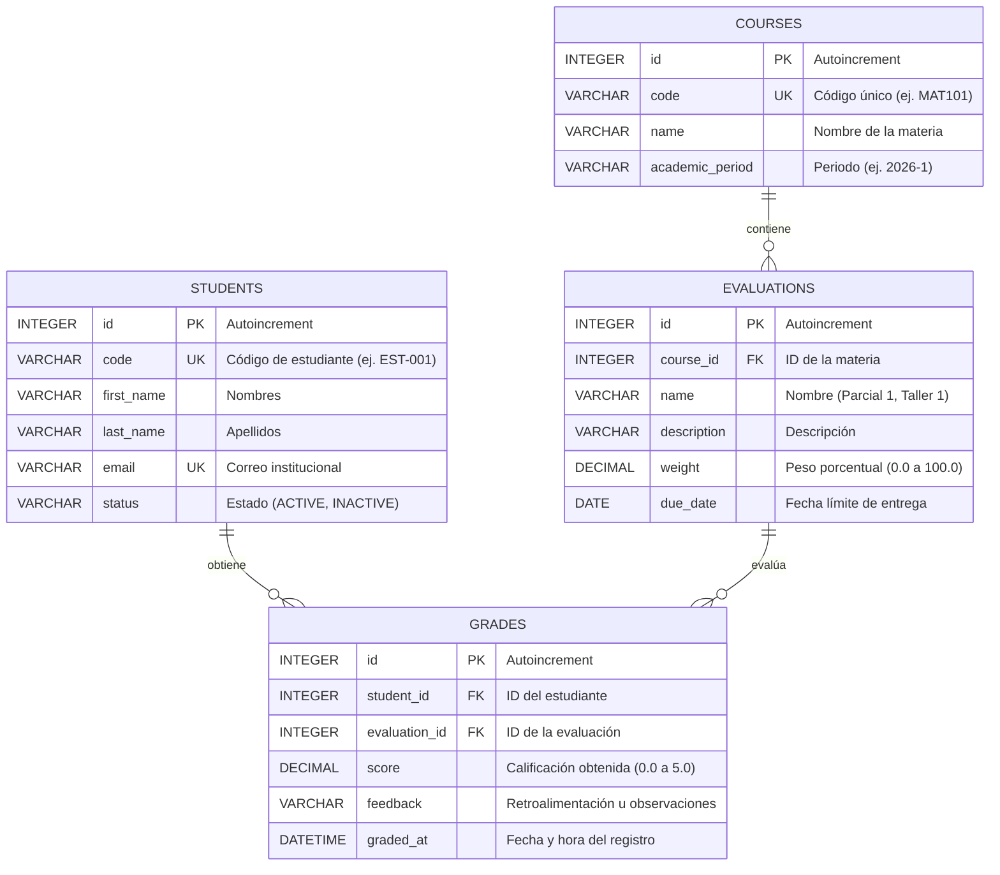
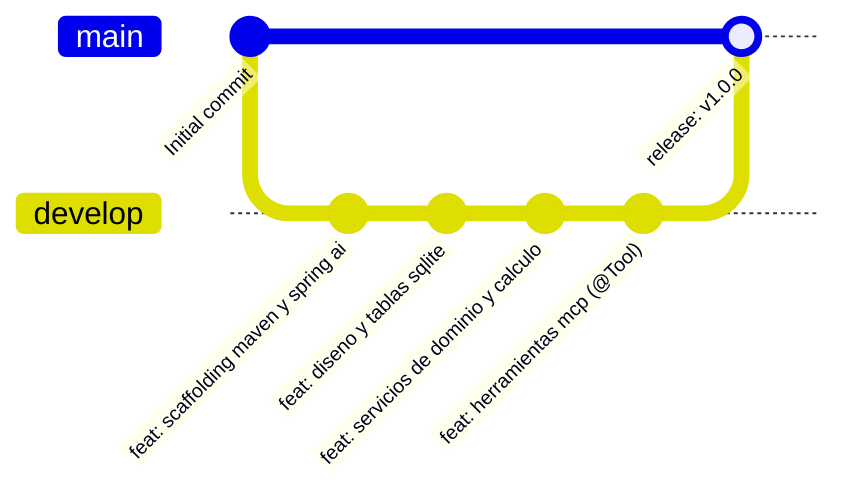

# Notas MCP Server 🎓

> **Servidor MCP (Model Context Protocol)** desarrollado en **Java 21** con **Spring AI** y base de datos local **SQLite**, diseñado para que asistentes y agentes de Inteligencia Artificial gestionen de forma autónoma y estructurada estudiantes, cursos, evaluaciones y calificaciones con cálculo automático de notas definitivas ponderadas.

---

## 📋 1. Definición del Proyecto

El **Notas MCP Server** actúa como un puente estandarizado mediante el protocolo abierto **Model Context Protocol (MCP)**, permitiendo a Modelos de Lenguaje (LLMs) como Claude, Gemini, ChatGPT o agentes autónomos interactuar con un sistema de gestión académica local.

### Objetivos Clave:
* **Autonomía para Asistentes IA:** Exponer herramientas tipadas (`@Tool`) que permiten registrar estudiantes, definir cursos y pruebas académicas con pesos porcentuales, asentar notas y calcular promedios ponderados.
* **Persistencia Ligera y Confiable:** Uso de una base de datos local **SQLite**, garantizando portabilidad sin necesidad de levantar infraestructura de bases de datos externa.
* **Código Limpio y Mantenible:** Aplicación estricta de principios **SOLID**, **Clean Code** y **Clean Architecture (Puertos y Adaptadores)** para separar el dominio académico de la infraestructura MCP y de base de datos.

---

## 🛠️ 2. Stack Tecnológico

| Componente | Tecnología | Versión | Justificación |
| :--- | :--- | :--- | :--- |
| **Lenguaje** | Java | 21 (LTS) | Uso de records, pattern matching, virtual threads y tipos inmutables. |
| **Framework Base** | Spring Boot | 3.4.x | Ecosistema maduro de inyección de dependencias, configuración y pruebas. |
| **Integración IA/MCP** | Spring AI | 1.0.0 | Soporte nativo de MCP Server con transporte STDIO (local) y SSE (HTTP). |
| **Base de Datos** | SQLite | 3.x | Base de datos embebida en archivo local (`notas.db`), sin dependencias de red. |
| **Capa de Persistencia** | Spring Data JPA + Hibernate Community | 6.x | Abstracción ORM con dialecto comunitario oficial de SQLite. |
| **Controlador JDBC** | `org.xerial:sqlite-jdbc` | 3.47.x | Driver JDBC nativo de alto rendimiento para SQLite. |
| **Gestor de Compilación**| Apache Maven + Maven Wrapper | 3.9.x (`mvnw`) | Builds reproducibles y portables entre entornos y CI/CD. |
| **Pruebas Unitarias** | JUnit 5 + AssertJ + Mockito | - | Verificación aislada de reglas de negocio y cálculo de notas. |

---

## 🏛️ 3. Arquitectura y Clean Code

El sistema adopta **Clean Architecture (Arquitectura Hexagonal / Puertos y Adaptadores)** para asegurar que las reglas del negocio educativo no dependan de frameworks externos:

```
┌────────────────────────────────────────────────────────────────────────┐
│                      INFRASTRUCTURE (Adaptadores)                      │
│                                                                        │
│   ┌─────────────────────┐                  ┌──────────────────────┐    │
│   │   MCP Server API    │                  │  SQLite Persistence  │    │
│   │   (@Tool Adapters)  │                  │  (Spring Data JPA)   │    │
│   └──────────┬──────────┘                  └──────────▲───────────┘    │
│              │                                        │                │
│              ▼                                        │                │
│   ┌───────────────────────────────────────────────────┴────────────┐   │
│   │                   APPLICATION (Casos de Uso)                   │   │
│   │                                                                │   │
│   │   • StudentService           • GradeCalculationService         │   │
│   │   • EvaluationService        • DTOs (Records inmutables)       │   │
│   │                                                                │   │
│   │   ┌────────────────────────────────────────────────────────┐   │   │
│   │   │                    DOMAIN (Núcleo)                     │   │   │
│   │   │                                                        │   │   │
│   │   │   • Student, Course, Evaluation, Grade                 │   │   │
│   │   │   • Repositories (Puertos / Interfaces)                │   │   │
│   │   │   • Reglas de Negocio (0.0 a 5.0, sumatoria ≤ 100%)    │   │   │
│   │   └────────────────────────────────────────────────────────┘   │   │
│   └────────────────────────────────────────────────────────────────┘   │
└────────────────────────────────────────────────────────────────────────┘
```

### Principios Clean Code aplicados:
1. **Single Responsibility (SRP):** Cada servicio se enfoca en un único agregado (estudiantes, evaluaciones o calificaciones).
2. **Inmutabilidad:** DTOs y modelos de transferencia modelados como Java `record`.
3. **Validación Temprana:** Excepciones de dominio específicas (`StudentNotFoundException`, `InvalidWeightException`, `GradeOutOfRangeException`).
4. **Desacoplamiento:** Los controladores MCP (`@Tool`) no conocen la base de datos directamente, interactúan mediante puertos de aplicación.

---

## 📁 4. Scaffolding del Proyecto

Estructura de directorios estandarizada:

```text
notas-mcp-server/
├── .mvn/
│   └── wrapper/
│       ├── maven-wrapper.jar
│       └── maven-wrapper.properties
├── src/
│   ├── main/
│   │   ├── java/com/aabg/notas/
│   │   │   ├── domain/                         # Núcleo del Dominio
│   │   │   │   ├── model/                      # Entidades y Value Objects puros
│   │   │   │   │   ├── Student.java
│   │   │   │   │   ├── Course.java
│   │   │   │   │   ├── Evaluation.java
│   │   │   │   │   └── Grade.java
│   │   │   │   ├── repository/                 # Puertos de salida (interfaces)
│   │   │   │   │   ├── StudentRepository.java
│   │   │   │   │   ├── CourseRepository.java
│   │   │   │   │   ├── EvaluationRepository.java
│   │   │   │   │   └── GradeRepository.java
│   │   │   │   └── exception/                  # Excepciones de negocio
│   │   │   │       ├── DomainException.java
│   │   │   │       ├── EntityNotFoundException.java
│   │   │   │       └── BusinessRuleException.java
│   │   │   ├── application/                    # Casos de uso
│   │   │   │   ├── dto/                        # Records inmutables (Input / Output)
│   │   │   │   │   ├── StudentDto.java
│   │   │   │   │   ├── CourseDto.java
│   │   │   │   │   ├── EvaluationDto.java
│   │   │   │   │   ├── GradeDto.java
│   │   │   │   │   └── FinalGradeReportDto.java
│   │   │   │   └── service/                    # Orquestadores de negocio
│   │   │   │       ├── StudentService.java
│   │   │   │       ├── CourseService.java
│   │   │   │       ├── EvaluationService.java
│   │   │   │       └── GradeCalculationService.java
│   │   │   ├── infrastructure/                 # Adaptadores tecnológicos
│   │   │   │   ├── persistence/                # SQLite + Spring Data JPA
│   │   │   │   │   ├── entity/                 # Entidades JPA
│   │   │   │   │   │   ├── StudentEntity.java
│   │   │   │   │   │   ├── CourseEntity.java
│   │   │   │   │   │   ├── EvaluationEntity.java
│   │   │   │   │   │   └── GradeEntity.java
│   │   │   │   │   ├── repository/             # Spring Data Interfaces
│   │   │   │   │   │   ├── JpaStudentRepository.java
│   │   │   │   │   │   ├── JpaCourseRepository.java
│   │   │   │   │   │   ├── JpaEvaluationRepository.java
│   │   │   │   │   │   └── JpaGradeRepository.java
│   │   │   │   │   └── adapter/                # Implementaciones de puertos
│   │   │   │   │       ├── StudentRepositoryAdapter.java
│   │   │   │   │       ├── CourseRepositoryAdapter.java
│   │   │   │   │       ├── EvaluationRepositoryAdapter.java
│   │   │   │   │       └── GradeRepositoryAdapter.java
│   │   │   │   └── mcp/                        # Servidor MCP y herramientas
│   │   │   │       ├── tool/                   # Herramientas @Tool expuestas al LLM
│   │   │   │       │   ├── StudentMcpTools.java
│   │   │   │       │   ├── CourseMcpTools.java
│   │   │   │       │   ├── EvaluationMcpTools.java
│   │   │   │       │   └── GradeMcpTools.java
│   │   │   │       └── config/                 # Configuración de MCP Server
│   │   │   │           └── McpServerConfig.java
│   │   │   └── NotasMcpApplication.java        # Punto de entrada Spring Boot
│   │   └── resources/
│   │       ├── application.yml                 # Configuración general y SQLite
│   │       ├── schema.sql                      # Inicialización DDL de SQLite
│   │       └── data.sql                        # Datos semilla opcionales
│   └── test/                                   # Pruebas automatizadas
│       └── java/com/aabg/notas/
│           ├── application/service/            # Pruebas unitarias de servicios
│           └── infrastructure/mcp/             # Pruebas de herramientas MCP
├── .gitignore
├── mvnw
├── mvnw.cmd
├── pom.xml
└── README.md
```

---

## 🗄️ 5. Diseño de Base de Datos (SQLite)

### Diagrama Entidad-Relación



### Reglas e Integridad de la Base de Datos:
1. **Escala de Calificación:** La columna `score` tiene constraint `CHECK (score >= 0.0 AND score <= 5.0)`.
2. **Ponderación de Pruebas:** Cada `weight` está validado entre `0.0` y `100.0`. La sumatoria de evaluaciones de un curso no puede superar el `100.0%`.
3. **Unicidad de Nota:** Constraint `UNIQUE(student_id, evaluation_id)` para impedir calificaciones duplicadas por prueba para un mismo alumno.
4. **Claves Foráneas Activas:** SQLite requiere habilitar explícitamente `PRAGMA foreign_keys = ON;`.

---

## ⚙️ 6. Capacidades y Herramientas MCP (`@Tool`)

El servidor MCP registra las siguientes herramientas para el agente o asistente:

| Herramienta | Entrada | Salida | Descripción |
| :--- | :--- | :--- | :--- |
| `add_student` | `code`, `firstName`, `lastName`, `email` | `StudentDto` | Registra un nuevo estudiante en el sistema. |
| `list_students` | Ninguna | `List<StudentDto>` | Retorna todos los estudiantes registrados. |
| `get_student` | `code` | `StudentDto` | Busca un estudiante por su código único. |
| `create_course` | `code`, `name`, `academicPeriod` | `CourseDto` | Registra una nueva asignatura o curso. |
| `list_courses` | Ninguna | `List<CourseDto>` | Lista las asignaturas activas. |
| `create_evaluation` | `courseCode`, `name`, `description`, `weight` | `EvaluationDto` | Crea una prueba asociada a un curso con su porcentaje. |
| `list_evaluations` | `courseCode` | `List<EvaluationDto>` | Consulta las evaluaciones programadas de un curso. |
| `record_grade` | `studentCode`, `evaluationId`, `score`, `feedback` | `GradeDto` | Asienta una calificación para un estudiante en una prueba. |
| `get_student_grades`| `studentCode`, `courseCode` | `List<GradeDto>` | Consulta el historial de notas de un alumno en un curso. |
| `calculate_final_grade`| `studentCode`, `courseCode` | `FinalGradeReportDto` | **Calcula la nota definitiva ponderada**, porcentaje acumulado y estado (Aprobado/Reprobado). |
| `get_course_summary` | `courseCode` | `CourseSummaryDto` | Genera el reporte consolidado de definitivas de todos los estudiantes de un curso. |

---

## 🌿 7. Estrategia de Ramas (Git Workflow)

El repositorio sigue un modelo de dos ramas principales:

* **`main`**: Rama de producción y versiones estables probadas y funcionales.
* **`develop`**: Rama base de integración y desarrollo continuo donde se implementan los features y herramientas.



---

## 🚀 8. Configuración e Instalación

### Requisitos Previos:
* Java JDK 21 o superior instalado.
* Git.

### Compilación:
```bash
./mvnw clean package -DskipTests
```

### Ejecución Local:
```bash
./mvnw spring-boot:run
```

### Configuración en Clientes MCP (ej. Claude Desktop / Cursor / Antigravity):
Agregar en el archivo de configuración de clientes MCP (`claude_desktop_config.json` o similar):

```json
{
  "mcpServers": {
    "notas-mcp-server": {
      "command": "java",
      "args": [
        "-jar",
        "/ruta/hacia/notas-mcp-server/target/notas-mcp-server-1.0.0.jar"
      ]
    }
  }
}
```

---

**Autor:** [Andrés Barrera Garavito](https://github.com/aabg1980)  
**Licencia:** Apache 2.0
